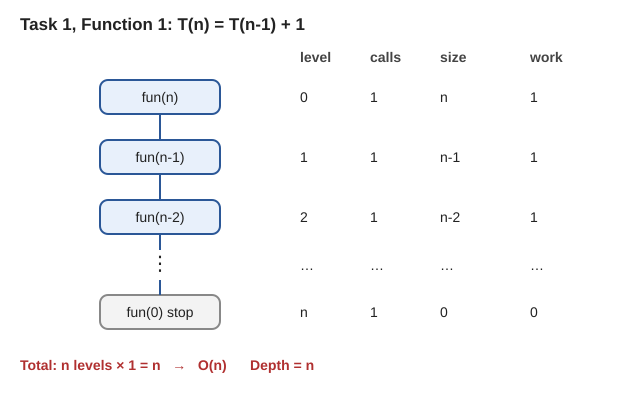
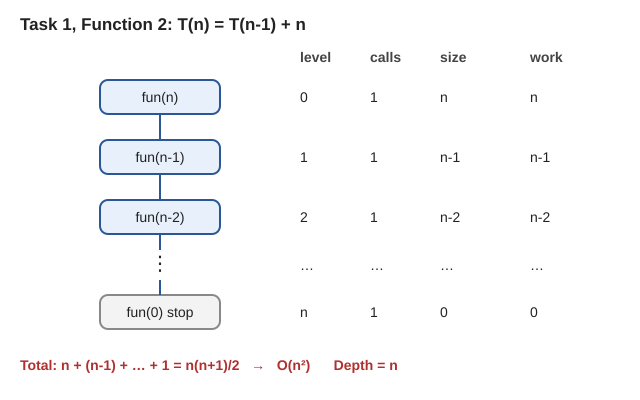
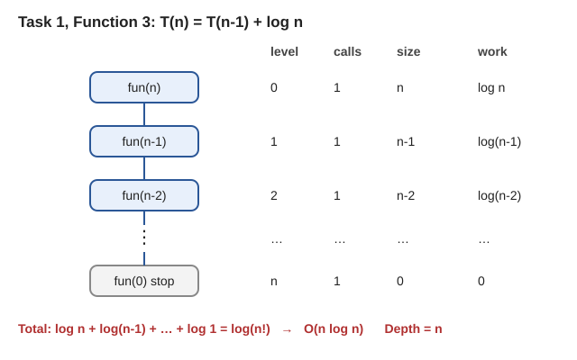
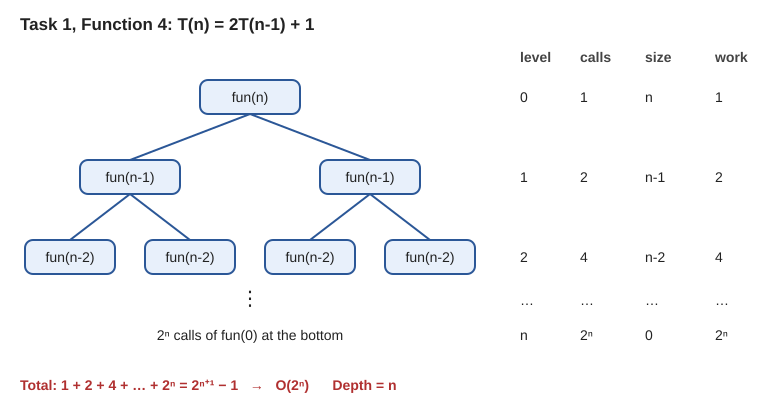
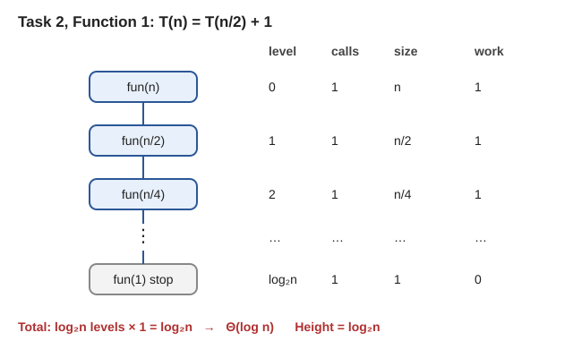
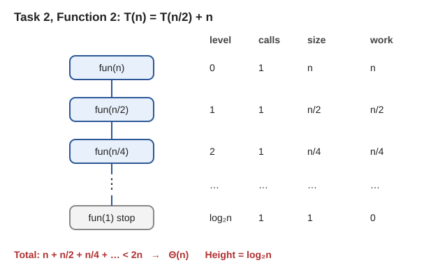
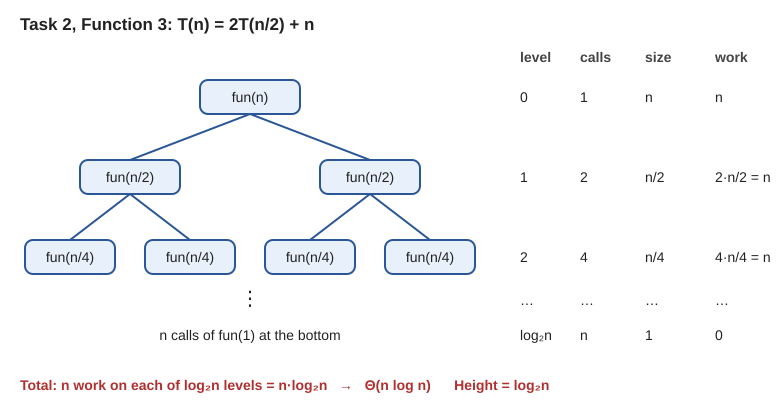

# DAA Coursework: Recurrence Relations and Master Theorem

Design and Analysis of Algorithms coursework.

In this work I analyze recursive functions. For every function I go through the same steps:

**Recursive code → work per call → recursive calls → recurrence relation → solution → time complexity**

## Repository structure

| Folder / file | What is inside |
|---|---|
| `README.md` | All analysis, calculations, comparisons and references |
| `code/Task1.java` | The 4 decreasing functions + a test that counts the steps |
| `code/Task2.java` | The 3 dividing functions + a test that counts the steps |
| `images/` | Recursion trees for all 7 functions |

How to run the code:

```
cd code
javac Task1.java Task2.java
java Task1
java Task2
```

In the code I replaced `System.out.println(n)` with a small method `work(n)`. It adds 1 to a counter `steps` (and prints `n` only if `PRINT = true`). This way I can see how many times the "work" happens and check if my formula is right.

## Contents

- [Basic idea: what is T(n)](#basic-idea-what-is-tn)
- [Task 1: Decreasing functions](#task-1-decreasing-functions)
  - [Master Theorem for decreasing functions](#master-theorem-for-decreasing-functions)
  - [Function 1: T(n) = T(n-1) + 1](#task-1--function-1-tn--tn-1--1)
  - [Function 2: T(n) = T(n-1) + n](#task-1--function-2-tn--tn-1--n)
  - [Function 3: T(n) = T(n-1) + log n](#task-1--function-3-tn--tn-1--log-n)
  - [Function 4: T(n) = 2T(n-1) + 1](#task-1--function-4-tn--2tn-1--1)
  - [Comparison of the four functions](#comparison-of-the-four-decreasing-functions)
- [Task 2: Dividing functions](#task-2-dividing-functions)
  - [Master Theorem for dividing functions](#master-theorem-for-dividing-functions)
  - [Function 1: T(n) = T(n/2) + 1](#task-2--function-1-tn--tn2--1)
  - [Function 2: T(n) = T(n/2) + n](#task-2--function-2-tn--tn2--n)
  - [Function 3: T(n) = 2T(n/2) + n](#task-2--function-3-tn--2tn2--n)
  - [Comparison of the three functions](#comparison-of-the-three-dividing-functions)
- [Checking with the code](#checking-with-the-code)
- [Final summary](#final-summary)
- [Resources](#resources)

---

## Basic idea: what is T(n)

`T(n)` is the time (number of steps) a function needs for input `n`.

When a function calls itself, its time also depends on itself with a smaller input. So we write an equation where `T` is on both sides. This is a **recurrence relation**.

To write it from code I ask three questions:

1. **How many times does the function call itself?** → this number goes before `T`.
2. **With what input does it call itself?** → `n - 1`, `n / 2`, …
3. **How much work does one call do apart from the recursive calls?** → `1` for a single statement, `n` for a loop that runs n times, and so on.

When `n` gets to the stop condition (`n > 0` or `n > 1` is false), the function does nothing. That is the base case, `T(0) = 1` or `T(1) = 1` (a constant).

To **solve** a recurrence I use two methods:

- **Back substitution**: put the formula into itself again and again until I see a pattern, then go down to the base case.
- **Recursion tree**: draw all calls level by level, count the work on every level, and add the levels together.

Then I check the answer with the **Master Theorem**.

---

# Task 1: Decreasing functions

In these functions the input gets **smaller by subtraction** (`n - 1`) in every call.

## Master Theorem for decreasing functions

General form:

```
T(n) = a·T(n - b) + f(n),     a > 0, b > 0, f(n) = O(n^k), k ≥ 0
```

- **a**: how many recursive calls each call makes
- **b**: how much `n` gets smaller in each call
- **f(n)**: work done outside the recursive calls

**Cases:**

| Case | Condition | Result | Simple meaning |
|---|---|---|---|
| 1 | a < 1 | O(n^k), i.e. O(f(n)) | the work goes down fast, the first call is the main part |
| 2 | a = 1 | O(n^(k+1)), i.e. O(n · f(n)) | one call per level, n levels, each does about f(n) |
| 3 | a > 1 | O(n^k · a^(n/b)) | the number of calls grows by a times every level, so it becomes exponential |

**How I choose the case:** first look at `a` (number of recursive calls). If there is one call, it is case 2. If there are more, it is case 3. Case 1 (a < 1) does not happen in real code, because a function cannot call itself "half a time".

**Why case 2 works:** with one call, the recursion is a chain `n → n-b → n-2b → … → 0`. It has about `n/b` levels, and every level does at most `f(n)` work. So the total is about `n · f(n)`.

**Why case 3 works:** with `a` calls, level `i` has `a^i` calls. There are `n/b` levels, so the last level has `a^(n/b)` calls. That number is the biggest part of the total.

---

## Task 1 – Function 1: T(n) = T(n-1) + 1

```java
void fun(int n) {
    if (n > 0) {
        System.out.println(n);
        fun(n - 1);
    }
}
```

### Deriving the recurrence from the code

- `System.out.println(n)` runs one time, so the work is **1**.
- `fun(n - 1)` is **one** recursive call with input `n - 1`, so it costs **T(n-1)**.
- When `n = 0` the `if` is false and nothing happens, so T(0) = 1 (constant).

```
T(n) = T(n-1) + 1,   T(0) = 1
```

### a, b, f(n)

| a | b | f(n) | k |
|---|---|---|---|
| 1 | 1 | 1 | 0 |

### Step-by-step solution (back substitution)

```
T(n) = T(n-1) + 1
     = [T(n-2) + 1] + 1   = T(n-2) + 2
     = [T(n-3) + 1] + 2   = T(n-3) + 3
     ...
     = T(n-k) + k
```

The recursion stops when `n - k = 0`, so `k = n`:

```
T(n) = T(0) + n = 1 + n
```

So **T(n) = n + 1 = O(n)**.

### Recursion depth

The chain is fun(n) → fun(n-1) → … → fun(0), which is **n + 1 calls**, so the depth is **n**.

### Recursion tree



There is only one call on every level, so the "tree" is really a straight line. Every level does 1 unit of work. n levels × 1 = n.

### Master Theorem

a = 1, so this is **case 2**: `O(n^(k+1)) = O(n^(0+1)) = O(n)`.

### Comparison

| Manual solution | Master Theorem |
|---|---|
| n + 1 = O(n) | O(n) |

Both give the same answer: **O(n)**.

---

## Task 1 – Function 2: T(n) = T(n-1) + n

```java
void fun(int n) {
    if (n > 0) {
        for (int i = 0; i < n; i++) {
            System.out.println(n);
        }
        fun(n - 1);
    }
}
```

### Deriving the recurrence from the code

- The `for` loop goes from `i = 0` to `i = n - 1`, which is **n** times. So the work is **n**.
- `fun(n - 1)` is **one** recursive call, which costs **T(n-1)**.

```
T(n) = T(n-1) + n,   T(0) = 1
```

### a, b, f(n)

| a | b | f(n) | k |
|---|---|---|---|
| 1 | 1 | n | 1 |

### Step-by-step solution (back substitution)

```
T(n) = T(n-1) + n
     = [T(n-2) + (n-1)] + n
     = [T(n-3) + (n-2)] + (n-1) + n
     ...
     = T(n-k) + (n-k+1) + ... + (n-1) + n
```

When `k = n`:

```
T(n) = T(0) + 1 + 2 + 3 + ... + n
     = 1 + n(n+1)/2
```

`n(n+1)/2 = n²/2 + n/2`. The biggest term is n², so **T(n) = O(n²)**.

### Recursion depth

The same chain as Function 1: **n** levels.

### Recursion tree



One call per level, but now level `i` does `n - i` work:
n + (n-1) + (n-2) + … + 1 = n(n+1)/2.

### Master Theorem

a = 1, so this is **case 2**: `O(n^(k+1)) = O(n^(1+1)) = O(n²)`.

### Comparison

| Manual solution | Master Theorem |
|---|---|
| n(n+1)/2 + 1 = O(n²) | O(n²) |

Same answer: **O(n²)**.

---

## Task 1 – Function 3: T(n) = T(n-1) + log n

```java
void fun(int n) {
    if (n > 0) {
        for (int i = 1; i < n; i = i * 2) {
            System.out.println(n);
        }
        fun(n - 1);
    }
}
```

### Deriving the recurrence from the code

- The loop starts at `i = 1` and **doubles** `i` each time: 1, 2, 4, 8, …
  It stops when `i ≥ n`. After `k` steps `i = 2^k`, so it stops when `2^k ≥ n`, i.e. `k = log₂ n`.
  So the loop runs about **log n** times.
- `fun(n - 1)` is **one** recursive call, **T(n-1)**.

```
T(n) = T(n-1) + log n,   T(0) = 1
```

### a, b, f(n)

| a | b | f(n) |
|---|---|---|
| 1 | 1 | log n |

### Step-by-step solution (back substitution)

```
T(n) = T(n-1) + log n
     = T(n-2) + log(n-1) + log n
     = T(n-3) + log(n-2) + log(n-1) + log n
     ...
     = T(0) + log 1 + log 2 + ... + log n
```

I use the rule `log a + log b = log(a·b)`:

```
log 1 + log 2 + ... + log n = log(1 · 2 · ... · n) = log(n!)
```

Now I need to know how big `log(n!)` is:

- **Upper bound:** every number in `1·2·…·n` is ≤ n, so `n! ≤ nⁿ` and `log(n!) ≤ n·log n`.
- **Lower bound:** the bigger half of the numbers (from n/2 to n) are all ≥ n/2, so `n! ≥ (n/2)^(n/2)` and `log(n!) ≥ (n/2)·log(n/2)`, which also grows like n·log n.

So `log(n!) = Θ(n log n)` and **T(n) = O(n log n)**.

### Recursion depth

One call per level, **n** levels.

### Recursion tree



Level `i` does `log(n - i)` work. All levels together: log n + log(n-1) + … + log 1 = log(n!).

### Master Theorem

a = 1, so this is **case 2**, `O(n · f(n)) = O(n · log n)`.

(f(n) = log n is not exactly `n^k`, but the case-2 rule "n levels × at most f(n) each" still works. It gives an upper bound n·log n, and the lower bound above shows it is tight.)

### Comparison

| Manual solution | Master Theorem |
|---|---|
| log(n!) = Θ(n log n) | O(n log n) |

Same answer: **O(n log n)**.

---

## Task 1 – Function 4: T(n) = 2T(n-1) + 1

```java
void fun(int n) {
    if (n > 0) {
        System.out.println(n);
        fun(n - 1);
        fun(n - 1);
    }
}
```

### Deriving the recurrence from the code

- `System.out.println(n)` runs one time, so the work is **1**.
- `fun(n - 1)` is called **two** times, so the cost is **2·T(n-1)**.

```
T(n) = 2T(n-1) + 1,   T(0) = 1
```

### a, b, f(n)

| a | b | f(n) | k |
|---|---|---|---|
| 2 | 1 | 1 | 0 |

### Step-by-step solution (back substitution)

```
T(n) = 2T(n-1) + 1
     = 2[2T(n-2) + 1] + 1        = 4T(n-2) + 2 + 1
     = 4[2T(n-3) + 1] + 2 + 1    = 8T(n-3) + 4 + 2 + 1
     ...
     = 2^k · T(n-k) + 2^(k-1) + ... + 2 + 1
```

The sum `1 + 2 + 4 + … + 2^(k-1) = 2^k - 1` (a geometric series).

When `k = n`:

```
T(n) = 2^n · T(0) + 2^n - 1
     = 2^n + 2^n - 1
     = 2^(n+1) - 1
```

So **T(n) = O(2ⁿ)**.

### Recursion depth

Each path goes n → n-1 → … → 0, so the depth is **n**. But this time the tree has **2 branches** at every node, so the number of calls doubles on every level.

### Recursion tree



| Level | Calls | Input size | Work on level |
|---|---|---|---|
| 0 | 1 | n | 1 |
| 1 | 2 | n-1 | 2 |
| 2 | 4 | n-2 | 4 |
| … | … | … | … |
| n | 2ⁿ | 0 | 2ⁿ |

Total: 1 + 2 + 4 + … + 2ⁿ = 2ⁿ⁺¹ − 1.

### Master Theorem

a = 2 > 1, so this is **case 3**: `O(n^k · a^(n/b)) = O(n^0 · 2^(n/1)) = O(2ⁿ)`.

### Comparison

| Manual solution | Master Theorem |
|---|---|
| 2ⁿ⁺¹ − 1 = O(2ⁿ) | O(2ⁿ) |

Same answer: **O(2ⁿ)**.

---

## Comparison of the four decreasing functions

| Function | Recurrence | a | b | f(n) | Depth | Case | Complexity |
|---|---|---|---|---|---|---|---|
| 1 | T(n-1) + 1 | 1 | 1 | 1 | n | 2 (a = 1) | **O(n)** |
| 2 | T(n-1) + n | 1 | 1 | n | n | 2 (a = 1) | **O(n²)** |
| 3 | T(n-1) + log n | 1 | 1 | log n | n | 2 (a = 1) | **O(n log n)** |
| 4 | 2T(n-1) + 1 | 2 | 1 | 1 | n | 3 (a > 1) | **O(2ⁿ)** |

From fastest to slowest: **O(n) < O(n log n) < O(n²) < O(2ⁿ)**.

What I learned:

- When there is **one** recursive call (a = 1), the answer is simply "n levels × work per level". The loop inside decides the result: no loop gives n, a `log n` loop gives n log n, an `n` loop gives n².
- Function 1 and Function 4 have the **same work per call (1)**. The only difference is the second recursive call, and it changes O(n) into O(2ⁿ). For n = 20, Function 1 does 20 steps but Function 4 does more than one million. So the number of recursive calls matters much more than the work inside one call.

---

# Task 2: Dividing functions

In these functions the input gets **smaller by division** (`n / 2`) in every call. Dividing makes the input small very fast, so the recursion is only about `log n` levels deep.

## Master Theorem for dividing functions

General form:

```
T(n) = a·T(n/b) + f(n),     a ≥ 1, b > 1, f(n) = Θ(n^k · log^p n)
```

- **a**: number of subproblems (recursive calls)
- **b**: by how much the input is divided
- **f(n)**: work outside the recursive calls (here `n^k · log^p n`, in our functions p = 0)

The main idea is to compare **log_b a** with **k**:

- `n^(log_b a)` is the number of leaves in the recursion tree (how much work the bottom does),
- `n^k` is the work at the top (the root).

The bigger one wins.

| Case | Condition | Result | Simple meaning |
|---|---|---|---|
| 1 | log_b a > k | Θ(n^(log_b a)) | the leaves do most of the work |
| 2 | log_b a = k | if p > -1: Θ(n^k · log^(p+1) n) | every level does the same work, multiply by the number of levels (log n) |
| 3 | log_b a < k | if p ≥ 0: Θ(n^k · log^p n) | the root does most of the work, so the answer is just f(n) |

(Case 2 also has sub-cases for p = -1 and p < -1, and case 3 for p < 0, but our functions all have p = 0, so I do not need them.)

**Height of the tree:** the input goes `n → n/b → n/b² → … → 1`. It reaches 1 when `n / b^h = 1`, so `h = log_b n`.

**How I choose the case:**
1. Find a, b, and k from f(n).
2. Calculate log_b a.
3. Compare it with k.

---

## Task 2 – Function 1: T(n) = T(n/2) + 1

```java
void fun(int n) {
    if (n > 1) {
        System.out.println(n);
        fun(n / 2);
    }
}
```

### Deriving the recurrence from the code

- `System.out.println(n)` runs one time, so the work is **1**.
- `fun(n / 2)` is **one** recursive call with half of the input, so it costs **T(n/2)**.
- When `n ≤ 1` nothing happens, so T(1) = 1.

```
T(n) = T(n/2) + 1,   T(1) = 1
```

### a, b, f(n)

| a | b | f(n) | k | p |
|---|---|---|---|---|
| 1 | 2 | 1 = n⁰ | 0 | 0 |

### Recursion tree



| Level | Number of calls | Input size | Work on level |
|---|---|---|---|
| 0 | 1 | n | 1 |
| 1 | 1 | n/2 | 1 |
| 2 | 1 | n/4 | 1 |
| i | 1 | n/2ⁱ | 1 |
| log₂n | 1 | 1 | stop |

### Height of the tree

`n / 2^h = 1` → `2^h = n` → **h = log₂ n**.

### Total work (step by step)

```
T(n) = T(n/2) + 1
     = T(n/4) + 1 + 1   = T(n/4) + 2
     = T(n/8) + 3
     ...
     = T(n/2^k) + k
```

Stop when `n/2^k = 1`, so `k = log₂ n`:

```
T(n) = T(1) + log₂ n = 1 + log₂ n
```

So **T(n) = Θ(log n)**. This is the same idea as binary search: we cut the problem in half each time.

### Master Theorem

log_b a = log₂ 1 = **0**, k = **0** → they are equal, so it is **case 2** (p = 0 > -1):

```
Θ(n^k · log^(p+1) n) = Θ(n^0 · log¹ n) = Θ(log n)
```

### Comparison

| Recursion tree / manual | Master Theorem |
|---|---|
| 1 + log₂n = Θ(log n) | Θ(log n), case 2 |

Same answer: **Θ(log n)**.

---

## Task 2 – Function 2: T(n) = T(n/2) + n

```java
void fun(int n) {
    if (n > 1) {
        for (int i = 0; i < n; i++) {
            System.out.println(n);
        }
        fun(n / 2);
    }
}
```

### Deriving the recurrence from the code

- The loop runs **n** times, so the work is **n**.
- `fun(n / 2)` is **one** call with half of the input, **T(n/2)**.

```
T(n) = T(n/2) + n,   T(1) = 1
```

### a, b, f(n)

| a | b | f(n) | k | p |
|---|---|---|---|---|
| 1 | 2 | n | 1 | 0 |

### Recursion tree



| Level | Number of calls | Input size | Work on level |
|---|---|---|---|
| 0 | 1 | n | n |
| 1 | 1 | n/2 | n/2 |
| 2 | 1 | n/4 | n/4 |
| i | 1 | n/2ⁱ | n/2ⁱ |
| log₂n | 1 | 1 | stop |

### Height of the tree

Same as before: **h = log₂ n**.

### Total work (step by step)

```
T(n) = n + n/2 + n/4 + n/8 + ... + 2
     = n · (1 + 1/2 + 1/4 + 1/8 + ...)
```

`1 + 1/2 + 1/4 + …` is a geometric series that never reaches 2 (each time we add half of what is left to 2). So:

```
n ≤ T(n) < 2n
```

For n a power of 2 the exact sum is `2n - 2` (plus the base case). So **T(n) = Θ(n)**.

Even though there are log n levels, the total is only about 2n, because the work gets twice smaller on every level. The first level (n) is already half of the total.

### Master Theorem

log_b a = log₂ 1 = **0**, k = **1** → 0 < 1, so it is **case 3** (p = 0 ≥ 0):

```
Θ(n^k · log^p n) = Θ(n¹ · log⁰ n) = Θ(n)
```

### Comparison

| Recursion tree / manual | Master Theorem |
|---|---|
| n + n/2 + … < 2n = Θ(n) | Θ(n), case 3 |

Same answer: **Θ(n)**.

---

## Task 2 – Function 3: T(n) = 2T(n/2) + n

```java
void fun(int n) {
    if (n > 1) {
        for (int i = 0; i < n; i++) {
            System.out.println(n);
        }
        fun(n / 2);
        fun(n / 2);
    }
}
```

### Deriving the recurrence from the code

- The loop runs **n** times, so the work is **n**.
- `fun(n / 2)` is called **two** times, so the cost is **2·T(n/2)**.

```
T(n) = 2T(n/2) + n,   T(1) = 1
```

### a, b, f(n)

| a | b | f(n) | k | p |
|---|---|---|---|---|
| 2 | 2 | n | 1 | 0 |

### Recursion tree



| Level | Number of calls | Input size | Work on level |
|---|---|---|---|
| 0 | 1 | n | n |
| 1 | 2 | n/2 | 2 · n/2 = n |
| 2 | 4 | n/4 | 4 · n/4 = n |
| i | 2ⁱ | n/2ⁱ | 2ⁱ · n/2ⁱ = n |
| log₂n | n | 1 | stop |

### Height of the tree

The input is still halved every time, so **h = log₂ n**. The last level has 2^(log₂ n) = **n** calls.

### Total work (step by step)

Every level does exactly **n** work: the number of calls doubles, but the input of each call is halved, so these two cancel out.

```
T(n) = n + n + n + ... + n      (log₂ n levels)
     = n · log₂ n
```

The same with back substitution:

```
T(n) = 2T(n/2) + n
     = 2[2T(n/4) + n/2] + n     = 4T(n/4) + 2n
     = 4[2T(n/8) + n/4] + 2n    = 8T(n/8) + 3n
     ...
     = 2^k · T(n/2^k) + k·n
```

When `n/2^k = 1`, `k = log₂ n` and `2^k = n`:

```
T(n) = n · T(1) + n·log₂ n = n + n·log₂ n
```

So **T(n) = Θ(n log n)**. This is the same recurrence as **Merge Sort**.

### Master Theorem

log_b a = log₂ 2 = **1**, k = **1** → they are equal, so it is **case 2** (p = 0 > -1):

```
Θ(n^k · log^(p+1) n) = Θ(n¹ · log¹ n) = Θ(n log n)
```

### Comparison

| Recursion tree / manual | Master Theorem |
|---|---|
| n + n·log₂n = Θ(n log n) | Θ(n log n), case 2 |

Same answer: **Θ(n log n)**.

---

## Comparison of the three dividing functions

| Function | Recurrence | a | b | f(n) | log_b a | k | Height | Case | Complexity |
|---|---|---|---|---|---|---|---|---|---|
| 1 | T(n/2) + 1 | 1 | 2 | 1 | 0 | 0 | log₂n | 2 (equal) | **Θ(log n)** |
| 2 | T(n/2) + n | 1 | 2 | n | 0 | 1 | log₂n | 3 (root wins) | **Θ(n)** |
| 3 | 2T(n/2) + n | 2 | 2 | n | 1 | 1 | log₂n | 2 (equal) | **Θ(n log n)** |

What I learned:

- All three trees have the same height **log₂ n**, because the input is always divided by 2.
- In Function 2 the work gets smaller on every level, so the top level is the most important one, and the answer is just f(n) = n.
- In Function 3 the work is the same on every level, so the answer is "work per level × number of levels" = n · log n.
- Dividing the input is much faster than subtracting from it. Compare `T(n-1) + 1 = O(n)` with `T(n/2) + 1 = O(log n)`, and `2T(n-1) + 1 = O(2ⁿ)` with `2T(n/2) + n = O(n log n)`.

---

## Checking with the code

I ran `code/Task1.java` and `code/Task2.java`. `steps` is how many times `println` would run.

### Task 1

| Function | n | steps (real) | formula | formula value |
|---|---|---|---|---|
| 1: T(n-1)+1 | 5 / 10 / 20 | 5 / 10 / 20 | n | 5 / 10 / 20 |
| 2: T(n-1)+n | 5 / 10 / 20 | 15 / 55 / 210 | n(n+1)/2 | 15 / 55 / 210 |
| 3: T(n-1)+log n | 5 / 10 / 20 | 8 / 25 / 69 | n·log₂n | 11.6 / 33.2 / 86.4 |
| 4: 2T(n-1)+1 | 5 / 10 / 20 | 31 / 1023 / 1048575 | 2ⁿ − 1 | 31 / 1023 / 1048575 |

For Function 3 the real count lies between log₂(n!) (6.9 / 21.8 / 61.1) and n·log₂n. This is because the loop runs ⌈log₂ k⌉ times (rounded up), not exactly log₂ k. It still grows like n log n.

For Function 4 the code counts only `println`, which happens in the 2ⁿ − 1 calls with n > 0. If we also count the 2ⁿ calls with n = 0 (each takes constant time), we get 2ⁿ⁺¹ − 1, exactly what I got by hand. Both are O(2ⁿ).

### Task 2

Here I use n = powers of 2 (16, 1024, 65536), so `n / 2` always divides evenly and the numbers match the formulas exactly.

| Function | n | steps (real) | formula | formula value |
|---|---|---|---|---|
| 1: T(n/2)+1 | 16 / 1024 / 65536 | 4 / 10 / 16 | log₂n | 4 / 10 / 16 |
| 2: T(n/2)+n | 16 / 1024 / 65536 | 30 / 2046 / 131070 | 2n − 2 | 30 / 2046 / 131070 |
| 3: 2T(n/2)+n | 16 / 1024 / 65536 | 64 / 10240 / 1048576 | n·log₂n | 64 / 10240 / 1048576 |

All the real numbers match the formulas, so the analysis is correct.

---

## Final summary

| Task | Recurrence | Method | Case | Complexity |
|---|---|---|---|---|
| 1.1 | T(n) = T(n-1) + 1 | decreasing | a = 1 | O(n) |
| 1.2 | T(n) = T(n-1) + n | decreasing | a = 1 | O(n²) |
| 1.3 | T(n) = T(n-1) + log n | decreasing | a = 1 | O(n log n) |
| 1.4 | T(n) = 2T(n-1) + 1 | decreasing | a > 1 | O(2ⁿ) |
| 2.1 | T(n) = T(n/2) + 1 | dividing | case 2 | Θ(log n) |
| 2.2 | T(n) = T(n/2) + n | dividing | case 3 | Θ(n) |
| 2.3 | T(n) = 2T(n/2) + n | dividing | case 2 | Θ(n log n) |

In every function the manual solution (back substitution / recursion tree) and the Master Theorem gave the same answer, and the program confirmed it with real numbers.

---

## Resources

1. T. H. Cormen, C. E. Leiserson, R. L. Rivest, C. Stein, *Introduction to Algorithms*, 3rd ed., MIT Press, 2009. Chapter 4: "Divide-and-Conquer" (recursion tree method, Master Theorem).
2. Abdul Bari, *Algorithms* course on YouTube, lectures 2.1.1 – 2.4 (recurrence relations for decreasing functions, Master Theorem for decreasing functions, recurrence relations for dividing functions, Master Theorem for dividing functions). https://www.youtube.com/@abdul_bari
3. GeeksforGeeks, "Master Theorem For Subtract and Conquer Recurrences". https://www.geeksforgeeks.org/dsa/master-theorem-subtract-conquer-recurrences/
4. GeeksforGeeks, "Master Theorem for Divide and Conquer Recurrences". https://www.geeksforgeeks.org/dsa/advanced-master-theorem-for-divide-and-conquer-recurrences/
5. Wikipedia, "Master theorem (analysis of algorithms)". https://en.wikipedia.org/wiki/Master_theorem_(analysis_of_algorithms)
6. Lecture materials of the Design and Analysis of Algorithms course.
